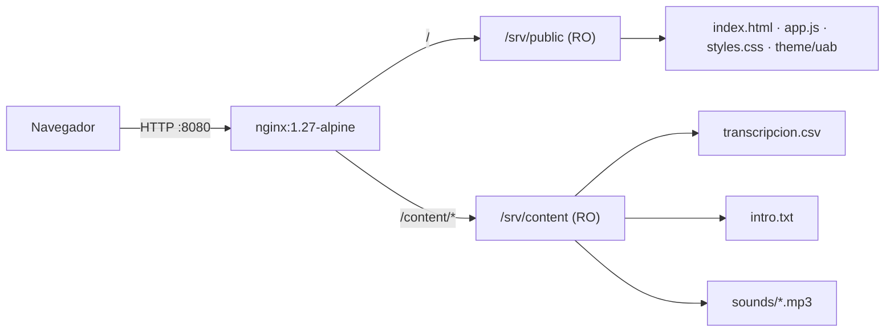

# Diccionario de transcripciones del chino

<i class="fa-solid fa-language"></i> Aplicación web dockerizada que muestra, de forma dinámica y filtrable, un diccionario de **correspondencias entre transcripciones del repertorio silábico chino**: Hanyu Pinyin, Wade-Giles y AFI, con reproducción de audio para cada sílaba.

<i class="fa-solid fa-cube"></i> El proyecto se sirve como sitio estático a través de **nginx** y no requiere backend propio: el catálogo se lee en el navegador desde un CSV, y los audios se enlazan directamente desde el sistema de ficheros.

---

## <i class="fa-solid fa-list-check"></i> Características

- <i class="fa-solid fa-table"></i> **Tabla dinámica** generada desde `content/transcripcion.csv`.
- <i class="fa-solid fa-sort"></i> **Ordenación por cualquier columna** (ascendente / descendente) con la columna activa resaltada en verde UAB.
- <i class="fa-solid fa-filter"></i> **Filtros acumulativos por columna** y **búsqueda global** que abarca todas las columnas a la vez.
- <i class="fa-solid fa-arrows-down-to-line"></i> **Scroll infinito**: carga inicial de 20 filas y bloques adicionales de 20 al llegar al final, sin límite de altura.
- <i class="fa-solid fa-hashtag"></i> **Contador de resultados**: «Mostrando X de Y resultados».
- <i class="fa-solid fa-volume-high"></i> **Reproductor de audio** por sílaba (`<audio controls>`) que enlaza a `content/sounds/<pinyin>.mp3`.
- <i class="fa-solid fa-link"></i> **URL compartible**: los filtros y el criterio de orden se reflejan en la URL, de forma que se puede recuperar un estado concreto al recargar.
- <i class="fa-solid fa-circle-info"></i> **Introducción embebida** (`content/intro.txt`) visible por defecto y cerrable con una X en la esquina superior derecha.
- <i class="fa-solid fa-palette"></i> **Interfaz en castellano** con el tema visual de la UAB: barra de prenavegación, cabecera con logo y menú principal, y tipografía corporativa.
- <i class="fa-solid fa-mobile-screen"></i> **Responsive**: adaptado a móvil y tableta, con cabecera de tabla sticky y filtros compactos.

---

## <i class="fa-solid fa-sitemap"></i> Arquitectura



---

## <i class="fa-solid fa-folder-tree"></i> Estructura del proyecto

```text
.
├── README.md
├── compose.yml              # Servicio nginx con volúmenes RO
├── Dockerfile               # Imagen mínima basada en nginx:1.27-alpine
├── nginx.conf               # Configuración de nginx (root + alias)
├── content/                 # Datos y audios (volumen RO)
│   ├── transcripcion.csv    # Fuente del diccionario (Hanyu/Wade/AFI)
│   ├── intro.txt            # Texto HTML de la introducción
│   └── sounds/              # MP3, uno por sílaba (a.mp3, ai.mp3, …)
└── public/                  # Frontend estático (volumen RO)
    ├── index.html
    ├── app.js
    ├── styles.css
    └── theme/
        └── uab/             # Tema visual de la UAB
            ├── css/header-styles.css
            └── img/logo-uab.svg
```

---

## <i class="fa-solid fa-rocket"></i> Puesta en marcha

### <i class="fa-solid fa-circle-check"></i> Requisitos

- Docker y Docker Compose v2 (`docker compose`).

### <i class="fa-solid fa-play"></i> Arranque

```bash
docker compose up -d
```

La aplicación queda disponible en:

```text
http://localhost:8080
```

### <i class="fa-solid fa-stop"></i> Detener

```bash
docker compose down
```

### <i class="fa-solid fa-rotate"></i> Reconstruir la imagen

Normalmente **no hace falta** reconstruir: los volúmenes `./public` y `./content` están montados en modo solo lectura, por lo que cualquier cambio en esos directorios se refleja al recargar el navegador. Solo es necesario reconstruir si modificas `nginx.conf` o el propio `Dockerfile`:

```bash
docker compose build --no-cache
docker compose up -d
```

---

## <i class="fa-solid fa-sliders"></i> Configuración

### <i class="fa-solid fa-server"></i> `nginx.conf`

- `root /srv/public` sirve el frontend estático (`index.html`, `app.js`, `styles.css`, `theme/…`).
- `alias /srv/content/…` sirve el CSV, la introducción y los audios desde una ruta independiente, evitando conflictos de montaje entre volúmenes RO.

### <i class="fa-solid fa-link"></i> Variables de URL

La aplicación guarda su estado en la barra de direcciones. Parámetros soportados:

| Parámetro     | Significado                                | Ejemplo           |
|---------------|--------------------------------------------|-------------------|
| `sort`        | Columna de ordenación                      | `sort=Wade-Giles` |
| `dir`         | Dirección (`asc` / `desc`)                 | `dir=asc`         |
| `q`           | Búsqueda global                            | `q=ch`            |
| `f_<columna>` | Filtro por columna (una clave por columna) | `f_AFI=%5Bts`     |

Ejemplo de URL restaurable:

```text
http://localhost:8080/?sort=Hanyu%20Pinyin&dir=asc&q=a&f_AFI=%5Bts
```

---

## <i class="fa-solid fa-database"></i> Fuente de datos

El diccionario principal vive en `content/transcripcion.csv`, con tres columnas:

```csv
"Hanyu Pinyin","Wade-Giles","AFI"
```

El frontend no asume más columnas que las declaradas en la cabecera del CSV: si añades nuevas columnas, aparecerán automáticamente en la tabla, serán ordenables y filtrables, y se incluirán en la búsqueda global.

### <i class="fa-solid fa-headphones"></i> Audios

Cada fila debe tener un MP3 asociado en `content/sounds/` cuyo nombre coincida **exactamente** con el valor de `Hanyu Pinyin`, incluyendo diéresis:

```text
content/sounds/a.mp3
content/sounds/ai.mp3
content/sounds/lü.mp3
content/sounds/nüe.mp3
```

Si un MP3 no existe, el reproductor del navegador mostrará un error sin romper el resto de la interfaz.

---

## <i class="fa-solid fa-code"></i> Desarrollo

### <i class="fa-solid fa-pen-to-square"></i> Editar el frontend

Los cambios en `public/index.html`, `public/app.js` o `public/styles.css` se reflejan al recargar la página (Ctrl+Shift+R para saltar la caché), porque `./public` está montado como volumen RO en `/srv/public`.

### <i class="fa-solid fa-file-csv"></i> Editar los datos

Los cambios en `content/transcripcion.csv` o `content/intro.txt` también se reflejan al recargar, porque `./content` está montado en `/srv/content`.

### <i class="fa-solid fa-music"></i> Añadir audios

Basta con copiar los nuevos MP3 a `content/sounds/`. No hace falta reiniciar el contenedor.

---

## <i class="fa-solid fa-brush"></i> Personalización del tema

El tema visual se inspira en el sitio de Publicacions de la UAB. Vive en `public/theme/uab/`:

- `css/header-styles.css`: estilos del header, aislados bajo `.uab-header-wrapper` para no interferir con la tabla.
- `img/logo-uab.svg`: logo. Sustitúyelo por el oficial si lo tienes.

Para cambiar de tema, crea una carpeta hermana (`public/theme/<nombre>/`) y referencia sus ficheros desde `index.html`. No hay build step: es HTML, CSS y JS planos.

---

## <i class="fa-solid fa-wrench"></i> Solución de problemas

| Problema                                            | Causa / solución                                                                              |
|-----------------------------------------------------|-----------------------------------------------------------------------------------------------|
| El CSV devuelve 404                                 | Comprueba que `content/transcripcion.csv` existe y que el volumen RO está bien montado.      |
| Los MP3 no suenan                                   | El nombre del fichero debe coincidir exactamente con `Hanyu Pinyin` (con diéresis: `lü.mp3`). |
| La tabla no muestra datos                           | Abre la consola del navegador y revisa si `fetch('/content/transcripcion.csv')` devuelve 200. |
| Los filtros no responden al instante                | Comportamiento intencionado: hay un *debounce* de 250 ms para no re-renderizar en cada tecla. |
| El header de la tabla no queda fijo al hacer scroll | Asegúrate de que `.table-wrapper` no tiene `overflow: auto` ni `overflow-x` en el breakpoint. |
| Cambios en `public/` no se reflejan                 | Recarga forzada con Ctrl+Shift+R; nginx envía `Cache-Control: no-cache` para HTML/CSS/JS.     |

---

## <i class="fa-solid fa-scale-balanced"></i> Licencia

Este proyecto se distribuye bajo la licencia **GNU General Public License v3.0 (GPLv3)**.

El *copyright* del código pertenece al **Servei de Publicacions de la Universitat Autònoma de Barcelona (UAB)**.

---

Desarrollado por **Marc Bria Ramírez** para el Servei de Publicacions de la Universitat Autònoma de Barcelona (UAB).
